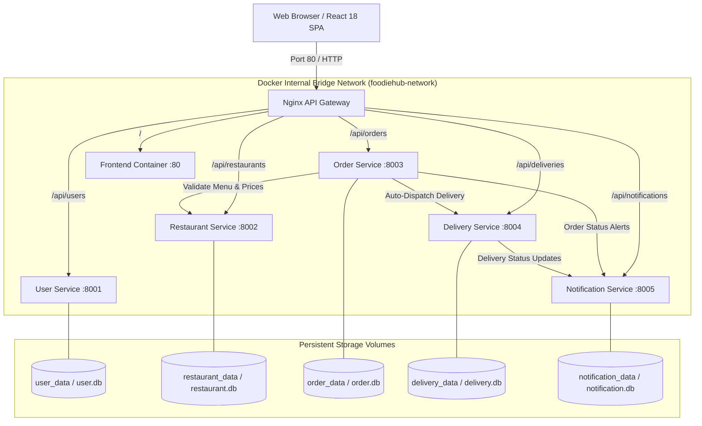
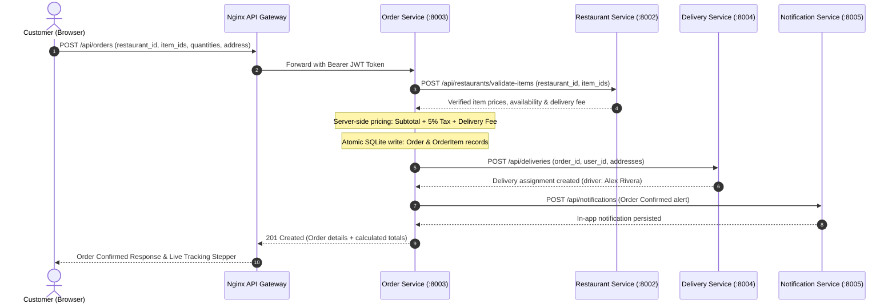

# FoodieHub — Cloud-Native Online Food Ordering System

[](https://github.com/nirma-cnd/foodiehub/actions)


> **Academic Project Deliverable** for *Cloud Native Applications (CND)*  
> B.Tech Computer Science & Engineering, Nirma University

---

## 1. Project Overview & Objectives

Traditional monolithic food delivery platforms suffer from tight coupling, single points of failure, difficult horizontal scaling, and slow deployment cycles.

**FoodieHub** addresses these challenges by implementing a production-grade, distributed **Cloud-Native Microservices Architecture**:
- **Independent Deployability**: Five self-contained FastAPI microservices, each with its own codebase, dependencies, Dockerfile, database, and test suite.
- **Database-per-Service Pattern**: Dedicated SQLite database per microservice backed by persistent Docker named volumes.
- **Unified API Gateway**: Nginx reverse proxy managing ingress, client routing, and single-port (`80`) exposure.
- **Zero-Trust Server-Side Pricing**: Client never dictates prices. All item totals, taxes (5%), and delivery fees are computed and verified server-side against catalog data.
- **Idempotent Operations**: Double-order prevention using unique idempotency keys on checkout.
- **Real-Time State Progression**: Live interactive order tracking with step progression and in-app notifications.
- **Comprehensive DevOps & Quality Assurance**: Docker Compose orchestration, automated health probes, GitHub Actions CI/CD workflows, and 40 automated unit/integration tests with 100% pass rate.

---

## 2. Technology Stack

| Domain | Technologies & Libraries |
| :--- | :--- |
| **Backend Microservices** | Python 3.10+, FastAPI, Pydantic v2, SQLAlchemy 2.x, Uvicorn, HTTPX |
| **Authentication & Security** | Passlib, Bcrypt (salted hashing), PyJWT (HS256, 32+ byte secret) |
| **Frontend Application** | React 18, TypeScript, Vite, Vanilla CSS design system, Lucide Icons |
| **Ingress & API Gateway** | Nginx Alpine (Reverse Proxy, Load Balancer, Static Assets) |
| **Storage & Persistence** | Isolated SQLite 3 databases per microservice + Docker Named Volumes |
| **Containerization** | Docker, Dockerfiles (multi-stage & slim), Docker Compose v2 |
| **CI/CD & Automation** | GitHub Actions (`.github/workflows/ci.yml`), Pytest, Pytest-Asyncio |

---

## 3. Architecture Diagram



---

## 4. Microservices Inventory

| Microservice | Internal Port | Database File | Docker Volume | Key Responsibilities |
| :--- | :---: | :--- | :--- | :--- |
| **User Service** | `8001` | `data/user.db` | `user_data` | JWT auth, bcrypt password hashing, user registration, profile management. |
| **Restaurant Service** | `8002` | `data/restaurant.db` | `restaurant_data` | Restaurant catalog, menus, categories, dish availability, server-side item validation. |
| **Order Service** | `8003` | `data/order.db` | `order_data` | Order placement, server-calculated totals, status state machine, user isolation, demo advance. |
| **Delivery Service** | `8004` | `data/delivery.db` | `delivery_data` | Courier dispatch, delivery lifecycle tracking, address management, duplicate check. |
| **Notification Service** | `8005` | `data/notification.db` | `notification_data` | In-app notification store, real-time unread badges, mark-as-read, deduplication. |
| **Frontend** | `80` (int) | Stateless | N/A | React 18, TypeScript, Vite, responsive UI, cart, live tracking, notification popups. |
| **API Gateway** | `80` | Stateless | N/A | Single point of ingress, Nginx reverse proxy, CORS mitigation, load balancing. |

---

## 5. Order Placement & State Machine Flow



### State Progression Lifecycle:
$$\text{PENDING} \longrightarrow \text{CONFIRMED} \longrightarrow \text{PREPARING} \longrightarrow \text{OUT\_FOR\_DELIVERY} \longrightarrow \text{DELIVERED}$$

---

## 6. Repository Directory Structure

```
FoodieHub/
├── .github/
│   └── workflows/
│       └── ci.yml                     # 3-job GitHub Actions CI/CD Pipeline
├── docs/
│   ├── architecture.md                # System design & microservices architecture
│   ├── api-reference.md               # Complete REST API route inventory
│   ├── testing.md                     # Test suite breakdown & execution guide
│   ├── demo-guide.md                  # 5-10 min viva presentation guide & Q&A
│   └── api_inventory.md               # API route catalog & contract specification
├── frontend/                          # React 18 + TypeScript + Vite SPA
│   ├── src/
│   │   ├── api/client.ts              # Centralized typed API client
│   │   ├── context/                   # AuthContext & CartContext state
│   │   ├── components/                # Navbar, Footer, StatusBadge, Notifications
│   │   ├── pages/                     # Home, RestaurantDetail, Cart, Checkout, OrderDetail
│   │   └── types/                     # TypeScript domain models
│   ├── Dockerfile                     # Multi-stage Node 20 + Nginx Alpine build
│   └── nginx.conf                     # Static file serving + SPA fallback
├── gateway/
│   ├── Dockerfile                     # Nginx Alpine Gateway image
│   └── nginx.conf                     # Ingress reverse proxy & microservice upstreams
├── services/
│   ├── user-service/                  # Identity, JWT, Profile microservice
│   │   ├── src/ (main, auth, models, routes, database, seed)
│   │   ├── tests/ (test_user_service.py)
│   │   └── Dockerfile
│   ├── restaurant-service/            # Restaurant catalog & menu microservice
│   │   ├── src/ (main, models, routes, database, seed)
│   │   ├── tests/ (test_restaurant_service.py)
│   │   └── Dockerfile
│   ├── order-service/                 # Order placement & state machine microservice
│   │   ├── src/ (main, client, models, routes, database)
│   │   ├── tests/ (test_order_service.py)
│   │   └── Dockerfile
│   ├── delivery-service/              # Courier dispatch & tracking microservice
│   │   ├── src/ (main, models, routes, database)
│   │   ├── tests/ (test_delivery_service.py)
│   │   └── Dockerfile
│   └── notification-service/          # In-app real-time alerts microservice
│       ├── src/ (main, models, routes, database)
│       ├── tests/ (test_notification_service.py)
│       └── Dockerfile
├── tests/
│   └── test_e2e_integration.py        # 7-step customer journey multi-service test
├── docker-compose.yml                 # 7-container Docker Compose orchestration
├── run_tests.py                       # Automated test runner across all services
├── start_local.ps1                    # Local development runner (all services)
├── stop_local.ps1                     # Local development shutdown script
├── .env.example                       # Documented environment configuration
├── .gitignore                         # Strict exclusion for *.db, .venv, node_modules
└── README.md                          # Main project documentation
```

---

## 7. Prerequisites & Installation

### System Requirements:
- **Python**: Version `3.10` or higher
- **Node.js**: Version `18.x` or `20.x` LTS + npm
- **Docker**: Docker Desktop with Compose v2 support (optional if running locally)

---

## 8. Exact Commands to Run, Inspect, and Test

### Option 1: Docker Compose (Full Containerized Stack)

```bash
# 1. Start the complete stack in background with volume persistence:
docker compose up --build -d

# 2. Inspect running container health status:
docker compose ps

# 3. View live unified logs:
docker compose logs -f

# 4. Restart a specific microservice:
docker compose restart order-service

# 5. Stop all containers (persisting database volumes):
docker compose down

# 6. Stop all containers and wipe persistent volumes (clean slate):
docker compose down -v
```

### Option 2: Local Development Scripts (PowerShell / Windows)

```powershell
# 1. Start all 5 microservices + frontend in separate background terminals:
.\start_local.ps1

# 2. Stop all local microservice processes:
.\stop_local.ps1
```

---

## 9. API Endpoints & Interactive Swagger Documentation

When running locally or via Docker Compose, access each microservice's interactive Swagger UI:

| Service | Swagger UI URL | Health Check Probe |
| :--- | :--- | :--- |
| **API Gateway Ingress** | [http://localhost](http://localhost) | `http://localhost/gateway-health` |
| **Frontend Web App** | [http://localhost:3000](http://localhost:3000) | `http://localhost:3000/` |
| **User Service** | [http://localhost:8001/docs](http://localhost:8001/docs) | `http://localhost:8001/health` |
| **Restaurant Service** | [http://localhost:8002/docs](http://localhost:8002/docs) | `http://localhost:8002/health` |
| **Order Service** | [http://localhost:8003/docs](http://localhost:8003/docs) | `http://localhost:8003/health` |
| **Delivery Service** | [http://localhost:8004/docs](http://localhost:8004/docs) | `http://localhost:8004/health` |
| **Notification Service** | [http://localhost:8005/docs](http://localhost:8005/docs) | `http://localhost:8005/health` |

---

## 10. Development Seed Accounts & Credentials

The databases automatically seed initial accounts and 4 authentic restaurants on startup:

| Account Role | Email Address | Password | Capabilities |
| :--- | :--- | :--- | :--- |
| **Customer** | `customer@foodiehub.com` | `Password123!` | Browse, Cart, Checkout, Live Order Tracking |
| **Administrator** | `admin@foodiehub.com` | `AdminPass123!` | Catalog creation, system-wide order view |
| **Courier Driver** | `driver@foodiehub.com` | `DriverPass123!` | Delivery updates, transit status management |

---

## 11. Testing & CI/CD Pipeline

### Running the Test Suite:
```bash
python run_tests.py
```
**Results:** **40/40 tests passing (100% success rate)** across all 5 microservices and the multi-service E2E integration suite.

### Running Frontend Checks:
```bash
cd frontend
npm run build
```
Executes TypeScript typechecking (`tsc`) and generates the optimized production bundle (`dist/`).

### GitHub Actions CI/CD Pipeline (`.github/workflows/ci.yml`):
Triggered automatically on every `push` and `pull_request` to `main`:
1. **`backend-tests`**: Sets up Python 3.11, installs all requirements, runs `python run_tests.py`.
2. **`frontend-checks`**: Sets up Node.js 20, runs `npm install`, validates TypeScript and builds Vite bundle.
3. **`docker-compose-validation`**: Validates compose syntax (`docker compose config`) and builds all 7 images.

---

## 12. Troubleshooting Guide

| Issue | Root Cause | Solution |
| :--- | :--- | :--- |
| Port conflict on `8001-8005` or `3000` | Another process is occupying the port | Run `.\stop_local.ps1` or run `netstat -ano \| findstr :8001` to find and kill the process. |
| Old database cache issue | Database already seeded with previous schema | Delete `services/*/data/*.db` or run `docker compose down -v` to reset volumes. |
| In-app notifications not appearing | Notification service down or polling interval delayed | Notifications poll every 12 seconds. Check `http://localhost:8005/health`. |
| Cross-origin (CORS) errors | Frontend making direct requests across different ports | Use the Gateway at `http://localhost` or ensure `CORS` middleware is active in FastAPI. |

---

## 13. Known Limitations & Future Improvements

To maintain architectural honesty and academic integrity:
- **SQLite Database Engine:** Chosen for zero-dependency local grading and ease of deployment. In enterprise production, each service would connect to its own managed PostgreSQL instance.
- **Polling vs WebSockets:** Real-time updates utilize HTTP short-polling (8s for orders, 12s for notifications). A future enhancement would implement Server-Sent Events (SSE) or WebSockets.
- **Message Broker:** Inter-service calls currently use direct HTTP REST via `httpx`. A future improvement would introduce an event bus (RabbitMQ / Apache Kafka) for true asynchronous event-driven choreographies.
- **No External Cloud SMTP / SMS:** Notification events are persisted as in-app notifications and displayed in the frontend notification center; external SMS/email gateways are not integrated.

---

## 14. Additional Documentation Links

For deeper academic and technical details, consult:
- **[Architecture & Design Document](docs/architecture.md)**
- **[Complete API Reference](docs/api-reference.md)**
- **[Testing & Quality Assurance Guide](docs/testing.md)**
- **[College Presentation & Demo Guide](docs/demo-guide.md)**
