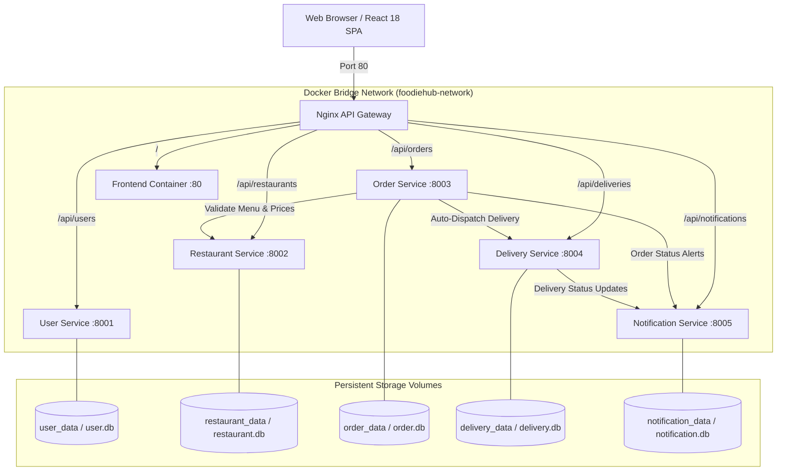
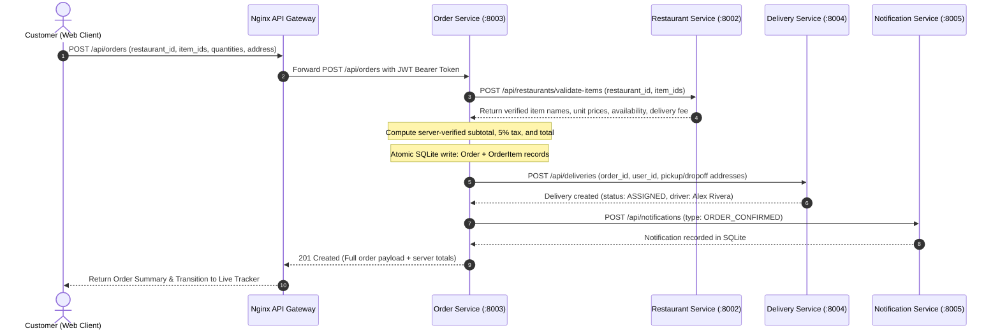

# FoodieHub — Architecture & System Design Documentation

## 1. Architectural Overview & Design Principles

FoodieHub is built following the **Cloud-Native Applications** architectural pattern, decomposing an online food ordering platform into five independently deployable, loosely coupled microservices fronted by an API Gateway.

### Key Architectural Tenets:
1. **Single Responsibility Principle (SRP):** Each microservice manages a single bounded context (Users, Catalog, Ordering, Courier Logistics, In-App Notifications).
2. **Database-per-Service:** No microservice shares database tables, connections, or files with another microservice. All persistence happens in isolated SQLite database files mounted to dedicated Docker named volumes.
3. **Zero-Trust Client Pricing:** Client applications never dictate line item prices or order totals. The Order Service computes all prices, taxes (5%), and delivery fees server-side by validating against the Restaurant Service.
4. **Idempotency:** Order creation and delivery assignment accept idempotency keys to ensure duplicate network transmissions do not generate duplicate orders or driver dispatches.
5. **Decoupled Asynchronous Inter-Service Communication:** Services communicate via resilient HTTP REST calls using `httpx` with timeout management and non-blocking failure fallbacks.

---

## 2. Microservice Boundaries & Responsibilities

| Microservice | Bounded Context | Tech Stack | Internal Port | Persistent Volume |
| :--- | :--- | :--- | :---: | :--- |
| **User Service** | Identity, authentication, user profiles | FastAPI, SQLAlchemy, Bcrypt, PyJWT | `8001` | `user_data` (`/app/data/user.db`) |
| **Restaurant Service** | Restaurant catalog, menus, categories, dish availability | FastAPI, SQLAlchemy | `8002` | `restaurant_data` (`/app/data/restaurant.db`) |
| **Order Service** | Checkout orchestration, server-side pricing, state machine | FastAPI, SQLAlchemy, HTTPX | `8003` | `order_data` (`/app/data/order.db`) |
| **Delivery Service** | Courier assignment, ETA calculation, transit status tracking | FastAPI, SQLAlchemy, HTTPX | `8004` | `delivery_data` (`/app/data/delivery.db`) |
| **Notification Service** | Real-time user notification events, unread badge counters | FastAPI, SQLAlchemy | `8005` | `notification_data` (`/app/data/notification.db`) |
| **API Gateway** | Ingress routing, reverse proxying, SPA fallback | Nginx Alpine | `80` | Stateless |
| **Frontend** | Responsive single-page application | React 18, TypeScript, Vite, CSS | `80` (int) | Stateless |

---

## 3. Order Placement & State Transition Lifecycle

### Phase 1: Order Creation Request Sequence

### Phase 2: State Progression Machine

Orders follow an enforced state progression:
$$\text{PENDING} \longrightarrow \text{CONFIRMED} \longrightarrow \text{PREPARING} \longrightarrow \text{OUT\_FOR\_DELIVERY} \longrightarrow \text{DELIVERED}$$

- **`CONFIRMED` $\rightarrow$ `PREPARING`:** Kitchen starts food preparation. Notification emitted: *"The kitchen has started preparing your order."*
- **`PREPARING` $\rightarrow$ `OUT_FOR_DELIVERY`:** Courier picks up food. Order Service synchronizes Delivery Service status to `IN_TRANSIT`. Notification emitted: *"Your order is out for delivery! Courier is en route."*
- **`OUT_FOR_DELIVERY` $\rightarrow$ `DELIVERED`:** Courier delivers order. Delivery Service status marked `DELIVERED`. Notification emitted: *"Your order has been delivered! Enjoy your meal."*
- **`CANCELLED`:** Allowed only from `PENDING` or `CONFIRMED`.

---

## 4. Ingress & API Gateway (Nginx)

The Nginx API Gateway serves as the single entry point (`port 80`) for the entire application:
- `/api/users/*` $\rightarrow$ `user-service:8001`
- `/api/restaurants/*` $\rightarrow$ `restaurant-service:8002`
- `/api/orders/*` $\rightarrow$ `order-service:8003`
- `/api/deliveries/*` $\rightarrow$ `delivery-service:8004`
- `/api/notifications/*` $\rightarrow$ `notification-service:8005`
- `/gateway-health` $\rightarrow$ Instant gateway status JSON probe
- `/*` $\rightarrow$ Static files with SPA `try_files $uri $uri/ /index.html` fallback

---

## 5. Security & Isolation Architecture

1. **JWT Authentication:** Cryptographically signed tokens (`HS256`, 32+ byte secret) shared across microservices via environment variables (`JWT_SECRET`).
2. **Role-Based Access Control (RBAC):**
   - `customer`: Can place orders, view own orders/deliveries/notifications, cancel pending orders.
   - `admin`: Can create restaurants, view system-wide metrics, advance any order status.
   - `driver`: Can view and update assigned delivery statuses.
3. **Object-Level Authorization:** Strict `order.user_id == current_user_id` checks prevent horizontal privilege escalation. User B cannot access User A's order or delivery details (`HTTP 403 Forbidden`).
4. **Password Security:** Salted `bcrypt` hashing ensures plain-text passwords never touch logs or databases.
